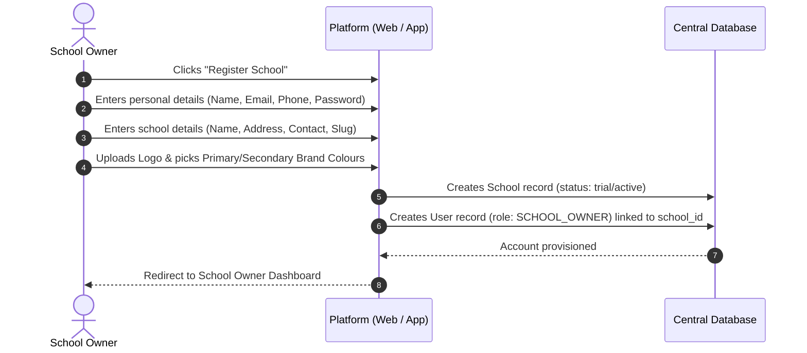
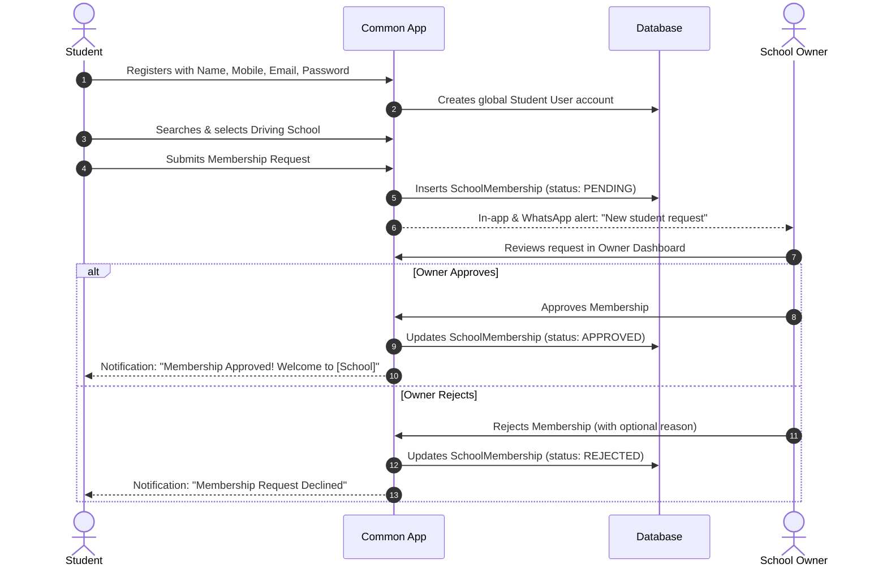
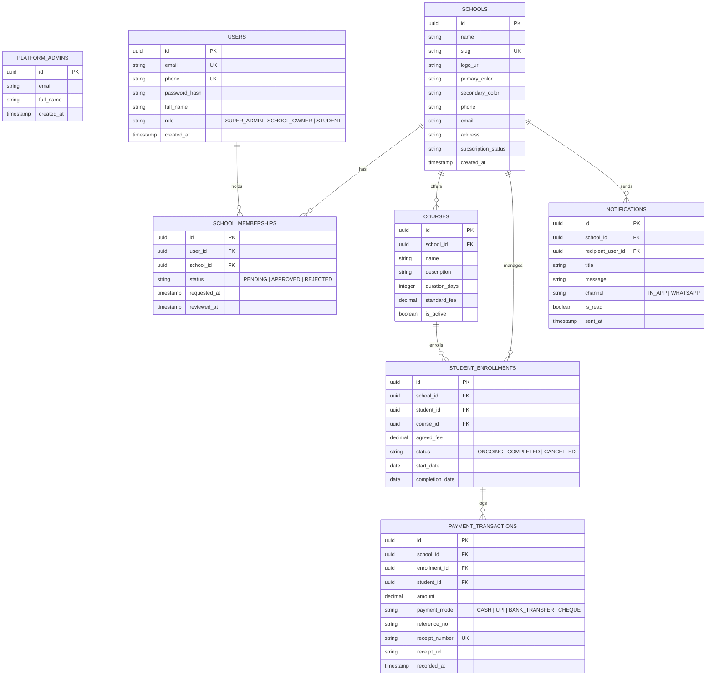

# PROJECT CONTEXT
# White-Label Driving School Management SaaS Platform

> **Status:** Architecture & Technical Blueprinting  
> **Last Updated:** 2026-11-05  
> **Target Deployment:** Web Application & Google Play Store (Android Mobile App)  
> **Multi-Tenancy Model:** Shared Database, Tenant Isolation via `school_id` / Row Level Security (RLS)

---

## 1. Project Overview

We are building a modern, multi-tenant SaaS platform designed specifically for driving schools.

The primary objective is to digitize and simplify the daily operations of driving schools by providing a centralized platform where school owners can manage students, registrations, courses, fees, payments, and communication.

This platform is not designed for a single driving school. It is intended to serve multiple independent driving schools through one common application.

Every driving school should have its own business identity, branding, students, courses, and financial records while using the same underlying platform.

### Core Concept
**Build once, serve multiple driving schools, maintain separate business identities and data.**

For example:
- *Patil Driving School*
- *Shree Sai Driving School*
- *Omkar Driving School*

All three schools use the same platform, but their business information and data remain completely separate.

Each school maintains:
- Its own business name.
- Logo and branding.
- Primary and secondary theme colours (dynamic theming on Web and Mobile).
- Contact information.
- Business address.
- Unique school URL / slug (e.g., `/school/patil-ds` or subdomain `patil.platform.com`).
- Student records.
- Course information.
- Payment records and branded receipts.

The platform provides a consistent experience while allowing each school to feel that it is using its own customized management application.

---

## 2. Main Objectives

1. Digitize driving school management.
2. Eliminate dependency on manual registers and spreadsheets.
3. Simplify student registration and approval.
4. Help school owners manage students efficiently.
5. Maintain accurate fee and payment records.
6. Provide students with access to their own information.
7. Improve communication between schools and students.
8. Provide school-specific branding and identity.
9. Build a scalable subscription-based SaaS business.
10. Make the platform suitable for mobile application expansion (Google Play Store).

---

## 3. User Roles & Access Control

The platform has three primary user roles:

### A. Super Admin (Platform Administrator)
Manages the overall SaaS platform rather than an individual driving school.
- View all registered driving schools.
- Manage school accounts.
- Monitor platform activity.
- Manage school subscriptions and billing plans.
- Activate, suspend, or deactivate school accounts.
- View overall platform statistics and revenue metrics.
- Manage platform-wide settings.

### B. School Owner (Tenant Admin)
Represents an individual driving school. Has access strictly to their own school's information.
- Register their driving school.
- Configure school branding, colours, logo, and business information.
- Access the school dashboard with real-time operational metrics.
- Manage student registrations (Approve/Reject requests).
- View and manage student profiles.
- Create and manage driving courses.
- Assign courses to approved students.
- Manage course fees and payment installments.
- Record student payments (Cash, UPI, Bank Transfer).
- Track outstanding fees and payment balances.
- Generate and download branded payment receipts.
- View transaction history.
- Send announcements and personal notifications (In-app + WhatsApp).
- Monitor daily school activity.

### C. Student (End User)
Students are the end customers of individual driving schools.
- Create a student account.
- Search for a driving school by name, code, or location.
- Select a driving school and submit a membership request.
- Track membership approval status in real-time.
- Access the personalized Student Dashboard once approved.
- View assigned course details, syllabus, and duration.
- Check payment history, outstanding balance, and download receipts.
- Receive in-app notifications and WhatsApp updates.
- Manage personal profile details.

---

## 4. School Registration & Onboarding Flow

Driving school owners can register independently:



After registration, owners can update their branding, business profile, and banking/UPI details anytime.

---

## 5. Student Registration & Membership Flow

Students register independently without waiting for manual data entry by the owner:



### Critical Architecture Rules for Memberships
- **User Account ≠ School Membership:** A student's user account exists globally. A membership links that user to a specific driving school.
- **Strict Gating:** Students cannot access school courses, fees, or data until membership status is `APPROVED`.
- **Multi-School Capability:** A student can hold memberships in multiple driving schools (e.g. 2-wheeler at School A, Heavy Vehicle at School B).
- **Tenant Scope:** A school owner can only view and act on membership requests directed to their own school.

---

## 6. Common Login System & Intelligent Routing

The application provides a unified login experience across Web and Mobile:

```
[ User enters Email/Phone + Password ]
                   │
                   ▼
       [ Authenticate Credentials ]
                   │
       ┌───────────┴───────────┐
       ▼                       ▼
[ Super Admin ]        [ Regular User ]
       │                       │
Redirect:                      ├─ Is School Owner? ──► Redirect: School Dashboard (/owner)
/admin/dashboard               │
                               └─ Is Student?
                                       │
                        ┌──────────────┴──────────────┐
                        ▼                             ▼
              [ Single Membership ]        [ Multiple Memberships ]
                        │                             │
            ┌───────────┴───────────┐         Show School Selection Screen
            ▼                       ▼
       [ APPROVED ]            [ PENDING ]
            │                       │
      Redirect to:            Redirect to:
     Student Portal         "Membership Under
    (/student/home)          Review" Screen
```

---

## 7. Core Application Modules (V1 Scope)

### Module 1: School Owner Dashboard
- **Key Metrics Tiles:** Total Students, Active Enrolled Students, Pending Membership Requests, Total Fees Collected, Outstanding Balance.
- **Recent Activity Feed:** Latest student registrations, latest payments recorded.
- **Quick Actions:** Record Payment, Enroll Student, Create Course, Send Announcement.
- **Strict Data Scope:** All analytics and lists are scoped strictly to `school_id`.

### Module 2: Student Management
- **List & Search:** Filter by status (Pending, Approved, Enrolled, Completed), search by name, phone, or registration number.
- **Student Profile View:** Personal contact info, joined date, assigned courses, payment transaction history, outstanding balance.
- **Membership Approval Workflow:** One-click approve/reject with automated student notification.
- **Course Enrollment Trigger:** Separate from membership approval.

### Module 3: Course Management
- **Course Catalog:** Create, edit, and toggle active/inactive status.
- **Course Details:** Course Name (e.g., *Four-Wheeler Basic + License*, *Two-Wheeler Refresher*), Duration (e.g., 20 Days, 1 Month), Fee Amount (₹ / $), Curriculum Description.
- **Course Assignment:** Owner assigns a course to an approved student with agreed fee and start date.

### Module 4: Fee & Payment Management
- **Fee Assignment:** Agreed course fee set at enrollment.
- **Payment Recording:** Supports Full Payment, Partial Installments, and Advance Bookings.
- **Payment Modes:** Cash, UPI (Google Pay, PhonePe, Paytm), Bank Transfer / Cheque.
- **Receipt Engine:** Generates instant digital receipts branded with the school's logo, colors, address, transaction ID, payment mode, balance remaining, and owner signature/stamp.
- **Immutable Financial Ledger:** Every payment is recorded as an individual immutable transaction. No silent updates or data overwriting. Balance = `Total Agreed Fee - SUM(Valid Transactions)`.

### Module 5: Notifications & Communication
- **In-App Notification Center:** Real-time bell alerts for owners and students.
- **WhatsApp Integration (Twilio / WhatsApp Business Cloud API):**
  - Instant alert on registration & approval.
  - Digital receipt link sent to student's WhatsApp on payment recording.
  - Fee reminder nudges for pending installments.
  - School announcements.

---

## 8. White-Label & Multi-Tenant Architecture

### Tenant Data Isolation (Row-Level Security)
Every tenant-owned table in PostgreSQL includes a `school_id` foreign key:
```sql
-- Enforced via Postgres RLS
CREATE POLICY tenant_isolation_policy ON students
    FOR ALL
    USING (school_id = current_setting('app.current_school_id')::uuid);
```
Under no circumstances can an API query return or mutate data across tenant boundaries.

### Dynamic White-Label Theming
Each school's branding configuration is loaded dynamically on both Web and Mobile:
```json
{
  "school_id": "sch_12345",
  "name": "Patil Driving School",
  "slug": "patil-ds",
  "logo_url": "https://cdn.platform.com/logos/patil.png",
  "theme": {
    "primary_color": "#1E40AF",
    "secondary_color": "#F59E0B",
    "accent_color": "#10B981",
    "font_family": "Inter"
  },
  "contact": {
    "phone": "+91 98765 43210",
    "email": "contact@patildrivingschool.com",
    "address": "Shop 4, City Center, Pune, MH"
  }
}
```

---

## 9. Mobile App & Google Play Store Strategy

Since the app will be published to the **Google Play Store**:

### Recommended Architecture: React Native with Expo (Hybrid Native)
- **Why Expo/React Native:**
  - Single TypeScript codebase power both the **Google Play Store Android App** and the **Web Application**.
  - Dynamic white-label theming supported out-of-the-box (React Context / ThemeProvider updates colors, logos, and headers based on active school).
  - Native performance with push notifications (Expo Notifications), camera/receipt uploads, and offline cache.

### Google Play Store Compliance Guidelines
1. **Google Play In-App Billing vs. Business Software:**
   - *Driving school SaaS subscriptions paid by owners* can be handled via standard payment gateways (Razorpay / Stripe) on web, or Google Play In-App Subscriptions if subscribing directly through the app.
   - *Physical driving school fees paid by students* to schools are considered **physical services (offline driving instruction)** and are **exempt from Google Play In-App Billing 30%/15% cut** (Google Play Policy allows third-party payment methods / UPI for real-world services).
2. **Account Deletion Requirement:**
   - Google Play mandates that apps supporting account creation must provide an in-app and web-based account & data deletion request option.
3. **Closed Testing Rule:**
   - New personal Google Play developer accounts require **at least 20 testers opted in for at least 14 days** before opening to production.

---

## 10. Database Schema (PostgreSQL Blueprint)



---

## 11. V1 Scope Boundaries (Strict Adherence)

| Module | In V1 Scope | Post-V1 (Explicitly Excluded) |
|---|---|---|
| **School Management** | Owner registration, logo/colour branding, profile setup | Custom white-label domains (DNS mapping) |
| **Student Management** | Self-registration, school selection, approval/rejection | Driving test performance scoring, automated attendance |
| **Courses** | Course creation, duration, fee setting, manual assignment | Online video lessons / LMS, interactive quizzes |
| **Finances** | Fee tracking, cash/UPI manual entry, installments, PDF receipts | Integrated payment gateway checkout (direct in-app student payment) |
| **Communication** | In-app alerts, basic WhatsApp registration & payment alerts | Automated AI chat bot, two-way WhatsApp conversational bot |
| **Operations** | *None* | Instructor allocation, car/fleet maintenance, fuel tracking, GPS tracking |

---

## 12. Next Action Plan & Milestones

1. **Phase 1: Environment & Foundational Architecture**
   - Initialize Git repository and project structure.
   - Set up backend API (Next.js App Router / Supabase PostgreSQL) with Row Level Security.
   - Configure authentication schema with role-based routing (Super Admin, Owner, Student).
2. **Phase 2: School Owner & Multi-Tenant Core**
   - School onboarding flow & dynamic theme/branding persistence.
   - Course management CRUD.
   - Student membership approval inbox.
3. **Phase 3: Student Flow & Enrollment**
   - Student registration, search schools directory, submit membership.
   - Course enrollment & fee assignment.
4. **Phase 4: Financial Ledger & Receipt Engine**
   - Record installments, calculate balances, auto-generate branded PDF receipts.
5. **Phase 5: Notification Service (In-App & WhatsApp)**
   - Trigger transactional notifications on membership approval & receipt creation.
6. **Phase 6: Mobile Client & Google Play Readiness**
   - Package via Expo / React Native, test dynamic theming on Android emulator/devices.
   - Prepare assets (icons, feature graphic, privacy policy) and setup Closed Testing track.
