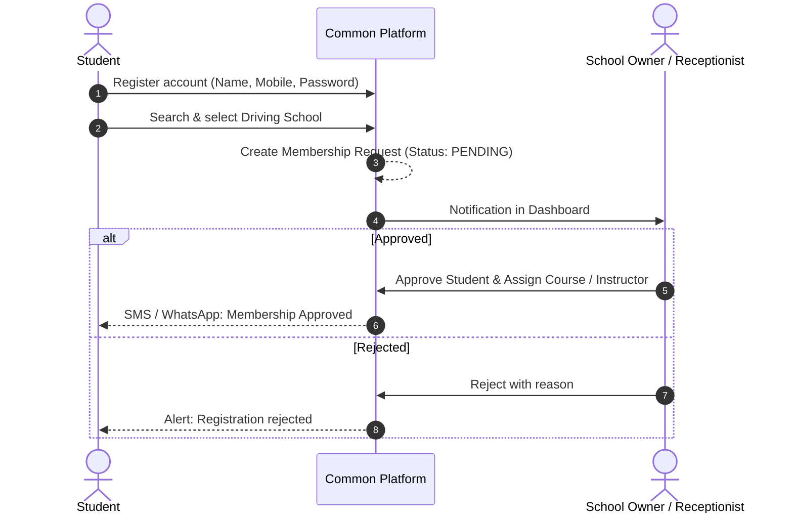
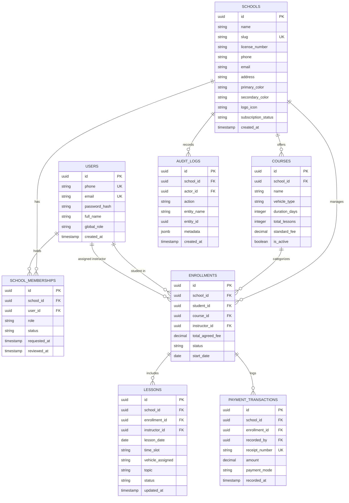

# White-Label Driving School Management SaaS Platform

> **Build once, serve multiple driving schools, maintain separate business identities and absolute data isolation.**

[](#system-architecture)
[](#multi-tenancy--tenant-isolation)
[](#technology-stack)
[](#spring-boot-backend-replaceability)
[](#mobile-first-design--google-play-readiness)

---

## 1. Project High-Level Overview

This platform is a modern, white-label, multi-tenant SaaS application purpose-built for independent driving schools. 

Instead of building custom software for every individual driving academy, this platform serves hundreds of independent schools through **one unified application** while guaranteeing that each school maintains its own:
- **Unique Business Identity:** Name, logo, primary & secondary brand colors, phone, address, and legal license number.
- **Dedicated School URL / Slug:** e.g., `/school/patil-ds`, `/school/shreesai-ds`, or custom subdomains.
- **Strict Data Isolation:** Students, driving courses, lesson schedules, payment transactions, and staff records remain completely private to each school.
- **Branded Digital Receipts:** Payment receipts automatically reflect the school's own branding, signature, and stamp.

---

## 2. System Architecture

The application is architected as a **Modular Monolith** with a decoupled REST API and a shared PostgreSQL database using **Row-Level Security (RLS)**.

```
       [ Web Browser (Desktop / Mobile) ]           [ Android App (Play Store) ]
                     │                                           │
                     ▼                                           ▼
      ┌─────────────────────────────────────────────────────────────────┐
      │          Unified REST API Layer (/api/v1, JSON, JWT)            │
      │              - Tenant Resolution Middleware                     │
      │              - Authentication & RBAC Authorization              │
      │              - Rate Limiting & Activity Auditing                │
      └────────────────────────────────┬────────────────────────────────┘
                                       │
                  ┌────────────────────┴────────────────────┐
                  ▼                                         ▼
   ┌───────────────────────────────────────────────────────────────────┐
   │                  MODULAR MONOLITH BACKEND                         │
   │  ┌───────────────┐  ┌────────────────┐  ┌──────────────────────┐  │
   │  │  auth/        │  │  schools/      │  │  memberships/        │  │
   │  ├───────────────┤  ├────────────────┤  ├──────────────────────┤  │
   │  │  users/       │  │  courses/      │  │  enrollments/        │  │
   │  ├───────────────┤  ├────────────────┤  ├──────────────────────┤  │
   │  │  lessons/     │  │  payments/     │  │  notifications/      │  │
   │  ├───────────────┤  ├────────────────┤  ├──────────────────────┤  │
   │  │  audit/       │  │  subscriptions │  │  common/ (DB, RLS)   │  │
   │  └───────────────┘  └────────────────┘  └──────────────────────┘  │
   └───────────────────────────────────┬───────────────────────────────┘
                                       │
                                       ▼
   ┌───────────────────────────────────────────────────────────────────┐
   │               SHARED POSTGRESQL MULTI-TENANT DATABASE             │
   │    - Tenant Discriminator Column: `school_id` on all entities     │
   │    - Engine-Level Defense: PostgreSQL Row-Level Security (RLS)    │
   │    - Immutable Ledger: Append-only financial transactions         │
   └───────────────────────────────────────────────────────────────────┘
```

### Core Architecture Pillars
1. **Modular Monolith over Microservices:** Single deployable codebase with strict internal domain boundaries. Eliminates unnecessary network hops, distributed transactions, and Kubernetes operational overhead.
2. **Database Multi-Tenancy via `school_id` + RLS:** All tenant entities contain a foreign key to the `schools` table. PostgreSQL Row-Level Security policies prevent cross-tenant data leaks even in the event of missing application-level filters.
3. **Decoupled Frontend & Backend via REST:** The frontend interacts solely through standard HTTP REST endpoints.
4. **Spring Boot Backend Replaceability:** By adhering strictly to OpenAPI/Swagger REST standards and standard JWT headers, the backend can be migrated to Java Spring Boot in the future with zero frontend rewrites.

---

## 3. User Roles & Permission Matrix

The platform supports 5 primary roles tailored to real-world driving school operations:

```
Role               Primary Device     Core Responsibility
─────────────────────────────────────────────────────────────────────────────────────────────
1. SUPER_ADMIN     Desktop Browser    Platform oversight, school onboarding, SaaS billing
2. SCHOOL_OWNER    Desktop + Mobile   Full school control, branding, staff, finances & audits
3. RECEPTIONIST    Desktop / Tablet   Walk-in admissions, fee collection, booking & receipts
4. INSTRUCTOR      Smartphone App     Daily calendar, 1-tap "Mark Done", WhatsApp alerts
5. STUDENT         Smartphone App     Syllabus progress, next lesson info, payment receipts
```

### Permission Capabilities

| Capability | Super Admin | School Owner | Receptionist | Instructor | Student |
|---|:---:|:---:|:---:|:---:|:---:|
| Manage All Driving Schools | **Yes** | No | No | No | No |
| Edit School Branding & Colors | **Yes** | **Yes** | No | No | No |
| Add / Remove Staff | No | **Yes** | No | No | No |
| Approve / Reject Student Requests | No | **Yes** | **Yes** | No | No |
| Create / Edit Driving Courses | No | **Yes** | No | No | No |
| Record Student Payments | No | **Yes** | **Yes** | No | No |
| View School Financial Totals | **Yes\*** | **Yes** | No | No | No |
| Schedule / Reschedule Lessons | No | **Yes** | **Yes** | **Own** | No |
| Mark Driving Lesson Completed | No | **Yes** | **Yes** | **Own** | No |
| View Personal Driving Progress | No | **Yes** | **Yes** | **Own** | **Own** |
| Download Branded Receipts | No | **Yes** | **Yes** | No | **Own** |

*\*Super Admin views platform subscription revenue, not individual school student tuition payments.*

---

## 4. Key Workflows & Human-First UX

### A. Independent School Onboarding
1. School owner registers personal and business details.
2. Selects a unique school slug (e.g. `patil-ds`) and custom brand colors.
3. School account is provisioned; dynamic CSS variables immediately skin the UI.

### B. Student Self-Registration & Approval


### C. 1-Tap Lesson Management for Instructors
- Instructors use the app while parked or on the road; tap targets are at least 44–48px.
- **Calendar Strip:** Interactive 4-day view (*Today, Tomorrow, Friday, Saturday*).
- **1-Tap Actions:**
  - `Mark Lesson Done`: Immediately updates lesson to `COMPLETED` and advances course progress.
  - `WhatsApp`: Opens WhatsApp with a pre-filled arrival alert (*"Hi Sophia, I am reaching your pickup spot in 5 minutes"*).
  - `Reschedule`: 1-tap modal to move a drive to a different day or time slot.

### D. Immutable Financial Ledger & Branded Receipts
- Fees are assigned upon course enrollment.
- Payments can be made in full, in installments, or recorded as \$0 advance bookings.
- Current balance is strictly computed as:
  $$\text{Balance} = \text{Agreed Course Fee} - \sum(\text{Valid Transaction Records})$$
- Each transaction generates a verifiable digital receipt with school logo, receipt number, payment mode (Cash, UPI, Card), and owner signature.

---

## 5. Database Schema (PostgreSQL Blueprint)



---

## 6. Multi-Tenancy & Tenant Isolation

Tenant isolation is enforced through a **Defense-in-Depth** model:

```sql
-- 1. Enable Row-Level Security on tenant table
ALTER TABLE students ENABLE ROW LEVEL SECURITY;

-- 2. Define policy checking active school session
CREATE POLICY tenant_isolation_policy ON students
    FOR ALL
    USING (
        school_id = NULLIF(current_setting('app.current_school_id', true), '')::uuid
        OR current_setting('app.user_role', true) = 'SUPER_ADMIN'
    );
```

When an HTTP request enters the backend:
1. **Tenant Resolution Middleware** extracts the tenant from the JWT, subdomain, or header (`X-School-ID`).
2. Inside the database transaction, it runs:
   ```sql
   SET LOCAL app.current_school_id = '<tenant_uuid>';
   SET LOCAL app.user_role = '<role>';
   ```
3. PostgreSQL automatically scopes all queries and mutations to that specific school. Cross-tenant leakage is impossible at the database engine level.

---

## 7. Technology Stack

### Frontend Application (`./frontend`)
- **Framework:** React 19 + TypeScript
- **Bundler:** Vite
- **Styling:** Tailwind CSS with dynamic CSS variable theming
- **Icons:** Material Symbols & Lucide
- **Responsive Layout:**
  - Desktop: Dedicated left sidebar for School Owner ([`Sidebar.tsx`](file:///c:/Users/prath/OneDrive/Desktop/D.Sas/frontend/src/components/Sidebar.tsx))
  - Mobile: Clean thumb-accessible bottom navigation bar ([`BottomNav.tsx`](file:///c:/Users/prath/OneDrive/Desktop/D.Sas/frontend/src/components/BottomNav.tsx))

### Target Backend (Phase 2)
- **Architecture:** Modular Monolith REST API
- **Language/Framework:** Node.js (TypeScript) + Express/Fastify (structured cleanly to allow 1:1 migration to Java Spring Boot)
- **Database:** PostgreSQL (with connection pooling via PgBouncer)
- **ORM / Migrations:** Drizzle ORM or Prisma
- **Validation:** Zod schemas
- **Auth:** Stateless JWT + Argon2/Bcrypt password hashing

### Mobile App (Phase 3)
- **Client:** React Native with Expo (shares React hooks, types, and REST API calls with Web)
- **Google Play Compliance:** Physical driving instruction fees are classified as offline physical services and are exempt from Google Play In-App Billing 15–30% digital cuts (direct UPI/cash transactions permitted).

---

## 8. Repository Structure

```
D.Sas/
├── README.md                      # Primary project source of truth & high-level blueprint
├── PROJECT_CONTEXT.md             # In-depth product specification, ERD & Play Store notes
├── frontend/                      # React 19 + TypeScript + Vite Web Application
│   ├── src/
│   │   ├── components/
│   │   │   ├── Header.tsx         # School branding header & role switcher
│   │   │   ├── Sidebar.tsx        # Desktop PC navigation sidebar for School Owner
│   │   │   ├── BottomNav.tsx      # Mobile phone navigation bar
│   │   │   ├── Toast.tsx          # Real-time action feedback toast
│   │   │   ├── modals/
│   │   │   │   ├── AddStudentModal.tsx       # Student admission with 1-tap deposit presets
│   │   │   │   ├── RecordPaymentModal.tsx    # Fee collection with balance auto-fill
│   │   │   │   ├── ScheduleLessonModal.tsx   # Lesson booking with 1-tap syllabus chips
│   │   │   │   ├── RescheduleLessonModal.tsx # 1-tap lesson rescheduling
│   │   │   │   ├── ReceiptModal.tsx          # Printable white-label payment receipt
│   │   │   │   └── TenantSwitcherModal.tsx   # Multi-school demonstration switcher
│   │   │   └── views/
│   │   │       ├── DashboardView.tsx     # School Owner 4-metric executive pulse
│   │   │       ├── StudentsView.tsx      # Student admissions, progress & search
│   │   │       ├── LessonsView.tsx       # Lesson timetable & status updates
│   │   │       ├── PaymentsView.tsx      # Fee ledger, balances & transaction history
│   │   │       ├── InstructorView.tsx    # Instructor 4-day calendar & WhatsApp reminders
│   │   │       └── StudentPortalView.tsx # Student course tracker & payment receipts
│   │   ├── context/
│   │   │   └── TenantContext.tsx  # Dynamic multi-tenant white-label theming & mock state
│   │   └── types/
│   │       └── index.ts           # Shared TypeScript domain contracts
│   ├── package.json
│   ├── tailwind.config.js
│   └── vite.config.ts
└── backend/                       # (Phase 2: Modular Monolith REST API & PostgreSQL)
```

---

## 9. Development Quickstart

### Prerequisites
- [Node.js](https://nodejs.org/) v18+ (tested on v20 and v22+)
- `npm` or `pnpm`

### Running the Frontend
```bash
# 1. Navigate to the frontend directory
cd frontend

# 2. Install dependencies (if not already installed)
npm install

# 3. Start local development server
npm run dev
```
Open your browser at `http://localhost:5173`.

### Verifying the Production Build
```bash
cd frontend
npm run build
```
Builds the production-ready static assets in `frontend/dist` with full TypeScript type-checking.

---

## 10. Project Milestones & Status

- [x] **Phase 1: Frontend & White-Label Theming System**
  - [x] React 19 + TypeScript + Vite project initialized.
  - [x] Dynamic CSS variable white-label theming implemented.
  - [x] Dedicated role views for School Owner, Receptionist, Instructor, and Student.
  - [x] Interactive 4-day calendar timeline with 1-tap lesson actions.
  - [x] 1-tap syllabus chips and fee presets added to forms.
  - [x] Production build verified with zero errors (`npm run build` in <700ms).
- [ ] **Phase 2: Modular Monolith Backend & Database**
  - [ ] PostgreSQL database schema with Row-Level Security (RLS).
  - [ ] JWT Authentication & Tenant Resolution Middleware.
  - [ ] REST API endpoints for Schools, Students, Lessons, and Payments.
  - [ ] Connect frontend state to persistent REST API endpoints.
- [ ] **Phase 3: Mobile Client & Google Play Store Readiness**
  - [ ] React Native / Expo mobile app configuration.
  - [ ] Android App Bundle (`.aab`) build pipeline via Expo EAS.
  - [ ] Google Play closed testing track setup.

---

## 11. Reference Documents

- **Detailed Product Context & ERD:** [`PROJECT_CONTEXT.md`](file:///c:/Users/prath/OneDrive/Desktop/D.Sas/PROJECT_CONTEXT.md)
- **Domain TypeScript Interfaces:** [`types/index.ts`](file:///c:/Users/prath/OneDrive/Desktop/D.Sas/frontend/src/types/index.ts)
- **Multi-Tenant State & Dynamic Theming:** [`TenantContext.tsx`](file:///c:/Users/prath/OneDrive/Desktop/D.Sas/frontend/src/context/TenantContext.tsx)

